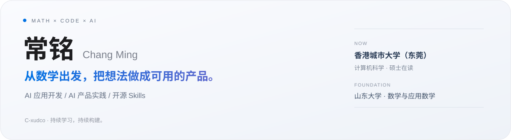
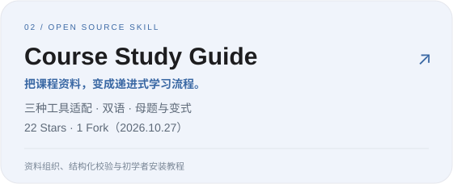

<a href="https://c-xudco.github.io/"><strong>完整作品集 ↗</strong></a> · <a href="#精选作品">项目作品</a> · <a href="#校园经历">校园经历</a> · <a href="mailto:changming2577@163.com">联系我</a>

## 你好，我是常铭

山东大学 **数学与应用数学本科**，香港城市大学（东莞）**计算机科学硕士在读**。我关注学习、AI 协作和桌面陪伴里的具体需求，借助 Codex 把想法推进为可体验产品，并通过测试、开源反馈与早期内测持续迭代。

目前关注 **AI 应用开发 / AI 产品工程** 与 **AI 产品实践**。具备 Python、Java、算法与数学基础，也有 React / Electron 桌面项目实践。

## 精选作品

  
  

**[水塘时钟 PondClock](https://c-xudco.github.io/#work)** · [交互演示](https://c-xudco.github.io/pond-demo/)

将时钟、天气与轻量钓鱼结合成无边框、可拖动、可置顶的 Windows 桌面挂件。无需账号，金币、鱼获、图鉴、物品、旅途和外观搭配保存在本机。借助 AI 多 agent 协作推进需求拆解、功能实现、界面检查与 Windows 交付。

早期内测出现“好治愈”“喜欢”、版本期待、推荐朋友和上线后购买意愿；这些是定性反馈与意向，尚不代表成交或留存结果。

**[Course Study Guide](https://github.com/C-xudco/course-study-guide)** · [安装与使用](https://github.com/C-xudco/course-study-guide#readme)

针对课程资料难以直接转化为可练习学案的需求，设计学习者、教师备课与母题变式模式，组织先修关系、双语详解、掌握核对表与结构化校验。提供 Codex、豆包、DeepSeek Harness 三种适配版本及初学者安装教程。**截至 2026.10.27：22 Stars、1 Fork**。

**其他作品**

- [Codex Token Memory](https://github.com/C-xudco/codex-token-memory)：本地会话 Token、缓存用量观察与用户选择的可复用记忆条目管理。
- [Modular Collaboration Guide](https://github.com/C-xudco/modular-collaboration-guide)：可编辑协作背景、模块化记忆与可视化面板。
- **影响力最大化算法（Java）**：基于网络信息扩散模型实现贪心近似求解、节点激活与概率传播，并进行复杂度分析与实验验证。

## 校园经历

| 任职 | 组织、执行与服务成果 |
| --- | --- |
| **会友棋社会长** · 本科大二 | 牵头威海 **4 所高校**区域象棋联赛，联合制定标准化赛制，统筹场地、人员与交通；赛事零事故落地并获电视台报道。 |
| **校园活动中心活动部部长** · 校级学生组织 · 本科大二 | 担任传统文化节策划及草地音乐节现场总控（**100+ 观众**），协调物资、动线与应急预案；设计并推行“执行小组积分激励制”。 |
| **数学与统计学院心理辅导站部长** · 院学生会 · 本科大二 | 推动心理咨询服务支持体系建设，独立策划 **20 余期**常态化心理观影活动，累计服务 **800+ 人次**。 |
| **社团发展中心服务管理部部长** · 本科期间 | 组织迎新大会、百团大战、社团之星等活动，以及会长大会、社团培训；负责文件归档与社团星级评定大会等工作。 |

## 教育与实习

**香港城市大学（东莞）** · 计算机科学硕士在读  
2026.09—2028.06（预计）｜研究兴趣：计算机视觉、3D 重建、机器学习与具身智能。

**山东大学** · 数学与应用数学本科  
2022.09—2026.06｜优秀心理委员、优秀志愿者、特长奖学金。

**青岛积成电子股份有限公司** · 软件开发实习生  
2026.01—2026.02｜参与 API 调试、数据获取与监控大屏可视化，执行功能测试、定位问题并编写技术文档。

**技术与语言**：Python · Java · C++ 基础 · React / Electron 项目实践 · AI Skills · 数据可视化 · 算法建模 · 功能测试 · CET-6 506 分。

## 联系与简历

[完整个人网站](https://c-xudco.github.io/) · [开发 / 工程版简历 PDF](https://github.com/C-xudco/c-xudco.github.io/blob/main/resume-engineering.pdf) · [AI 产品经理版简历 PDF](https://github.com/C-xudco/c-xudco.github.io/blob/main/resume-product.pdf)  
**邮箱**：[changming2577@163.com](mailto:changming2577@163.com)
